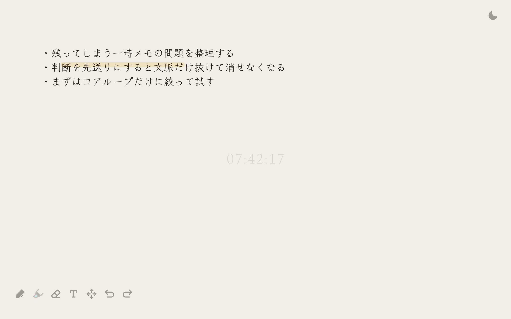
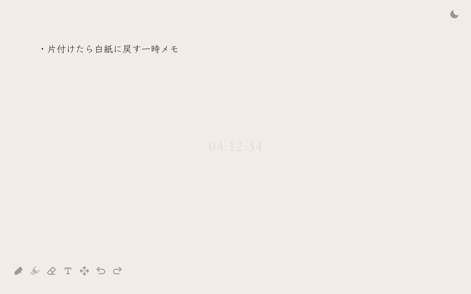
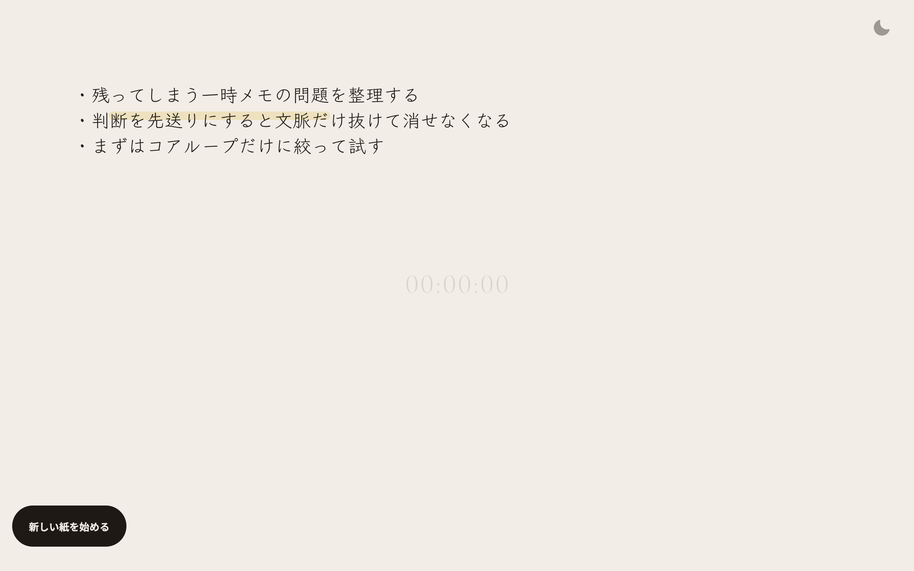

# 8HOUR｜8時間だけ使える一枚の紙

描き始めた瞬間から8時間のカウントダウンが始まる、思考の種を受け止めるための個人用メモアプリです。

Notionのような体系化されたドキュメント置き場でも、ToDoアプリのような確定タスクの管理でも、AIチャットのような壁打ち相手でもありません。まだ仕様にもタスクにもプロンプトにもなっていない思考の種を、1日の稼働時間である8時間だけ手元に広げて書き殴るための裏紙として作られています。サーバーとの通信は一切行わず、すべてブラウザローカルで完結します。



## 8時間という時間制約と一枚の紙

フォルダ分け、タグ付け、保存ボタン、過去ログ一覧は一切ありません。

1. **描き始めるとタイマーが始動**：白紙のキャンバスにある `08:00:00` の状態から、最初のストロークまたはテキストを書き込んだ瞬間に8時間のカウントダウンが始まります。
2. **すべて消せば時間は巻き戻る**：8時間以内にすべてのメモを消しゴムやUndoで消して白紙に戻すと、タイマーはアニメーションとともに `08:00:00` へリセットされ、待機状態に戻ります。

   

3. **8時間経過で紙をロック**：8時間が経過して `00:00:00` になるとその紙への追記・編集はロックされ、下部のボタンから白紙の新しいシートに切り替えます。

   

## 主な機能

1. **画面全体に広がる無地の紙**
   - 画面全体を1枚の紙として扱い、中央には残り時間を示すタイマーが背景として静かに刻まれます。
   - ウィンドウを縮小しても端のメモが画面外へ見切れないよう、メモの表示位置とスケールがビューポートに合わせて自動追従します。
   - 移動・並べ替えツールを選んでいる間は、2本指ピンチで1〜3倍までズーム・パンが可能です。
2. **道具バー**
   - ペン、マーカー、消しゴム、テキスト、移動・並べ替えの5種に加え、Undo・Redoボタンを備えています。
   - ペンとテキストは黒・赤・青の3色、マーカーはシアン・マゼンタ・イエローの3色から選択でき、ツールバーのアイコンの穂先にも選択中の色が反映されます。ダークモードでは暗い紙でも読める明度に自動で置き換わります。
   - Escapeキーで選択中の道具を解除し、道具なしの状態へ戻せます。
   - PCなどの大画面では左下に道具バー、右下にカラーバー、右上にダークモード切替ボタンを配置し、スマートフォンなどの小さい画面では下部中央に道具バー、左上にカラーバー、右上にダークモード切替ボタンを配置します。
3. **テキスト入力**
   - 道具バーでテキストを選んでタップするか、何も選択していない状態でキーボードから直接文字を打ち始めると入力欄が開きます。
   - テキストは行に沿った1ページの文章として入力します。空白部分をタップするか直接キー入力を始めると、文章の末尾の次の行から続けて書き、まだ何もなければ書き込み領域の左上の行から始まります。画面上下のUIを避け、左右に余白を取った書き込み領域の右端で自動的に折り返します。
   - EnterまたはShift+Enterで改行し、確定はEscapeまたは紙の別の場所のタップ、モバイルでは確定ボタンで行います。日本語IME変換中のEnterやEscapeでは誤確定しません。既存の文字をタップするとその場で再編集でき、空にして確定すると削除されます。
   - 行頭の `- ` や `* ` は `・ ` に自動変換され、`・ `、`1. `、`(1) ` で始まる行はリスト項目になります。項目行で改行すると次の項目記号が自動で入り、後ろの連番も自動で振り直されます。記号だけの空項目でもう一度改行するとリストを抜け、TabとShift+Tabでインデントを増減できます。モバイルではキーボード直上にリスト・インデント・確定のアイコンバーが表示されます。
4. **移動・並べ替え**
   - 手描きメモをドラッグすると、紙の領域内に収まる範囲で平行移動できます。
   - 複数行のテキストメモは、行をドラッグ＆ドロップして順番を入れ替えられます。折り返された行はまとめて1行として扱われ、入れ替え後は番号付きリストの連番も自動で振り直されます。
5. **消しゴム**
   - ドラッグで触れた部分だけをその場で消す手動削除です。手描きメモはストロークが分断される場合に複数本へ分割され、すべての点が消えたメモは自動的に削除されます。テキストは触れた行のみが消えて空行となり、末尾の空行は自動で取り除かれます。
6. **Undo / Redo**
   - 道具バーのボタンおよびキーボードの `Ctrl+Z` / `Cmd+Z`、`Ctrl+Shift+Z` / `Cmd+Shift+Z` で最大50履歴まで操作を遡れます。履歴はブラウザの `localStorage` に重複排除つきで保存され、リロードしても維持されます。新しい紙を始めると履歴も紙と一緒に消去されます。
7. **ダークモード切替**
   - 右上のボタンから1クリックでライトテーマとダークテーマを切り替えられます。テーマに応じて背景とインクの表示色が自動的に切り替わり、視認性を保ちます。

## 開発・ビルド

サーバーとの通信を行わない、ブラウザローカルで完結する静的Webアプリケーションです。データの永続化にはブラウザの `localStorage` のみを使用しています。

- **技術スタック**：TypeScript + Vite + Canvas API
- **テスト**：Vitest

```bash
npm install
npm run dev           # 開発サーバー起動
npm run build         # 本番ビルド
npm run preview       # ビルド成果物のローカル確認
npm run test          # ユニットテスト実行
npm run check:hygiene # コミット・ファイルの衛生検査
```

## コミット・PR の規則

`npm install` で有効化される `.githooks/` と CI の `npm run check:hygiene` で自動検査します。

- **コミットメッセージ**：1行目は `<type>(<scope>): <日本語の要約>` の Conventional Commits 形式で記述し、本文を続ける場合は1行空けます。
  - 使える `type`：`feat`, `fix`, `perf`, `refactor`, `docs`, `test`, `chore`, `style`, `build`, `ci`, `revert`, `security`
  - 1行目の要約には PR 番号 `#123` や鉤括弧・丸括弧を使いません。PR のタイトルも同様です。
- **トレーラー**：`Co-Authored-By:` は使用可能です。`Claude-Session:` や `https://claude.ai/code/session_...` などのセッション URL・ID はコミットメッセージ・PR 本文・コメントすべてで記載しません。
- **プライベート情報の禁止**：
  - コード・スクリプト・ドキュメント・コミット・PR 本文に個人のローカルパスを残しません。
  - Git の Author / Committer メールアドレスにはローカルホスト名や個人のメールアドレスを使わず、GitHub の `users.noreply.github.com` アドレスを使用します。

## 開発の経緯

本リポジトリは、jig.jp インターンシップ 2026 でのチーム開発成果物をベースにしています。

インターン終了後、思考の種を受け止める個人用作業台としての純度を高めるため、サーバー通信や過去ログ管理を排し、8時間だけ使える一枚の紙としてコンセプトとUIを再設計しました。

## ライセンス

[MIT License](LICENSE) のもとで公開しています。
